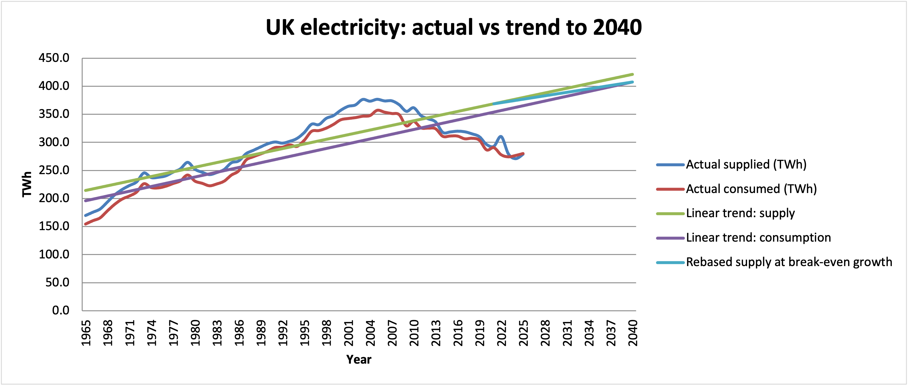
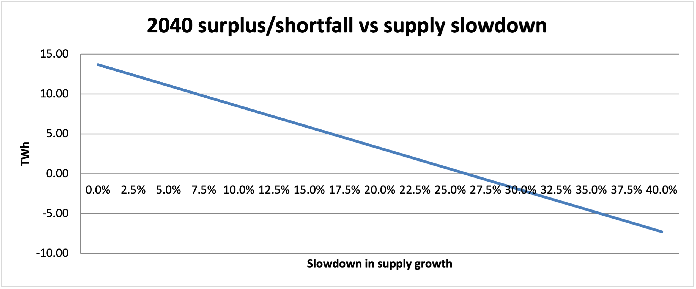

# UK Electricity Gap Forecast (Excel)

Will UK electricity consumption overtake electricity supply before 2040? And if not, how much would supply growth have to slow down for that to happen?

This started as a university group project. I've rebuilt the analysis from scratch in Excel using the latest official data, so every number here can be traced back to the spreadsheet.

## Data

- **Source:** DESNZ, Digest of UK Energy Statistics (DUKES), [*Electricity since 1920*](https://www.gov.uk/government/statistical-data-sets/historical-electricity-data), Supply, Availability & Consumption table (TWh)
- **Series:** Electricity supplied (net) and total electricity consumed, 1965 to 2025
- **Licence:** Open Government Licence v3.0
- **Note:** the series changes basis in 1986/87 (DUKES note 7). Before that it only covers major power producers, and from 1987 it covers all generating companies. Details are on the Data tab.

## Method

1. Fit straight-line trends (least squares) to supply and consumption, using 1965 to 2022 for the main result.
2. Project consumption on its trend to 2040.
3. Restart supply from its trend value in 2021, then solve for the yearly supply growth that only just meets 2040 demand.
4. Compare that with the fitted supply growth to get the **break-even slowdown**.
5. Test a range of slowdowns (0–40%) on the Sensitivity tab.
6. Try cubic fits as a comparison. They go negative by 2040, so I didn't use them.

All of it is live formulas. Change the fit end year on the Model tab and everything updates.

## Results

On the 1965–2022 trends, consumption reaches about 408 TWh in 2040. Supply stays ahead, and the two trend lines don't cross until around 2275, because their slopes are almost identical.

**Supply growth would have to slow by about 26% from 2021 onwards for demand to overtake supply before 2040.** Anything less than that still leaves a surplus.

| Fit window | Consumption trend (TWh/yr) | Supply trend (TWh/yr) | Break-even slowdown |
|---|---|---|---|
| 1965–2022 (original project) | 2.82 | 2.76 | **26.1%** |
| 1965–2025 (latest data) | 2.43 | 2.30 | **22.3%** |

Adding the last three years of data lowers the threshold to about 22%. Both trends flatten, but supply flattens more.

## Limitations

- **The straight line is the weakest assumption.** Consumption peaked around 2005 and has fallen since, so a trend starting in 1965 overstates recent demand growth. Treat the result as a stress test of long-run trends, not a forecast.
- **Imports aren't counted as supply.** Net imports through interconnectors would widen the margin.
- **The crossover year is fragile.** The two slopes are so close that small data revisions move it by decades.
- **Electrification isn't modelled.** EVs and heat pumps could push demand back up, which a backward-looking trend can't capture.

## Files

- `UK_Electricity_Gap.xlsx`: the model (tabs: Notes, Data, Model, Sensitivity, Forecast)
- `images/`: the charts above, generated from the same data and checked against the spreadsheet's result
